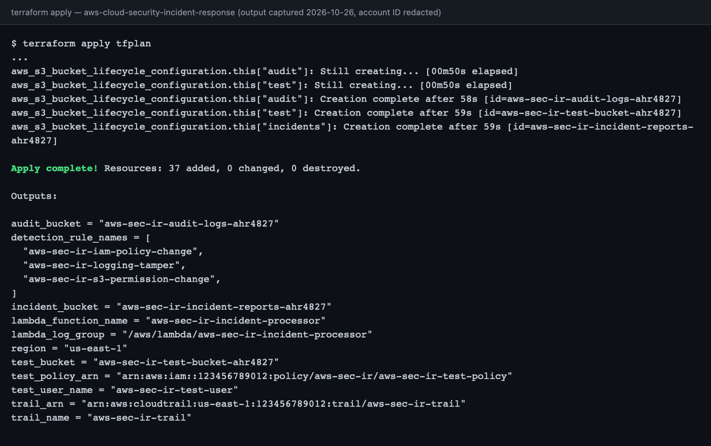
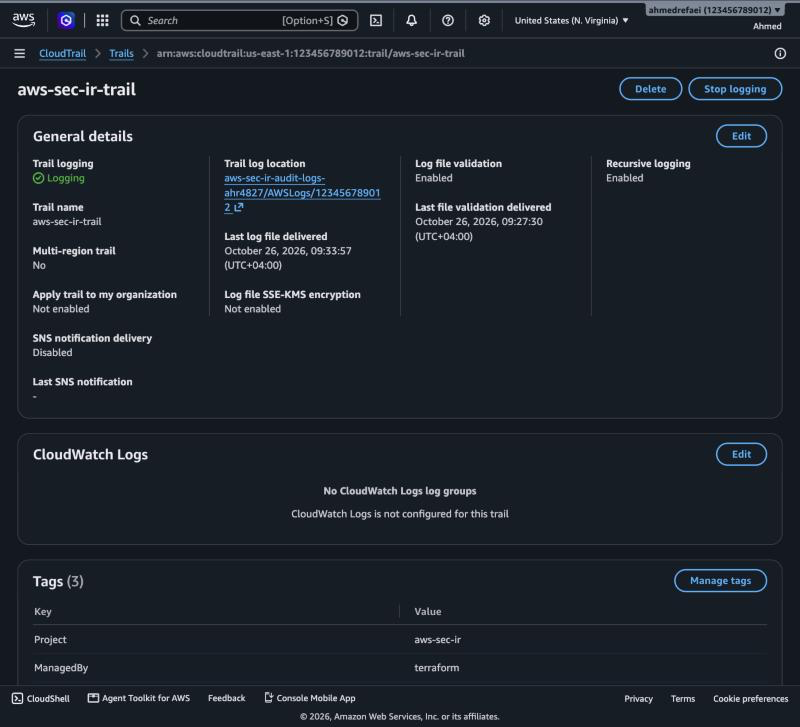
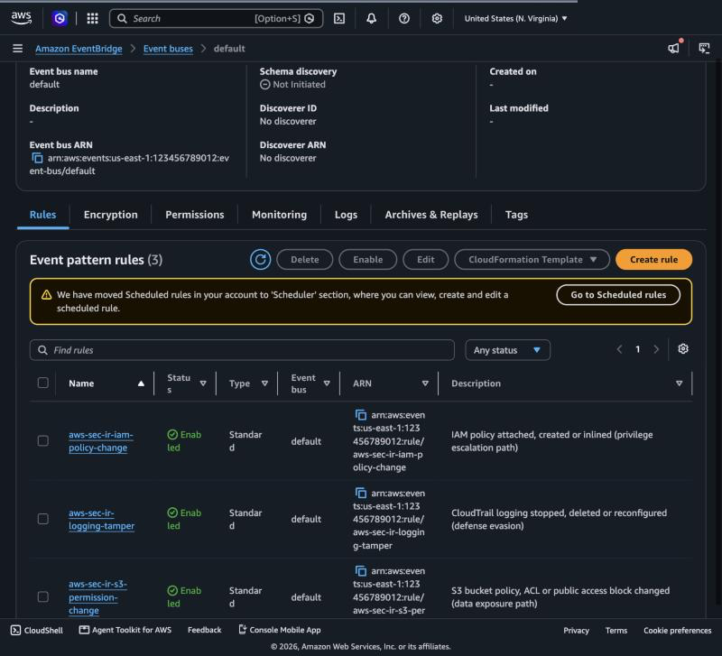
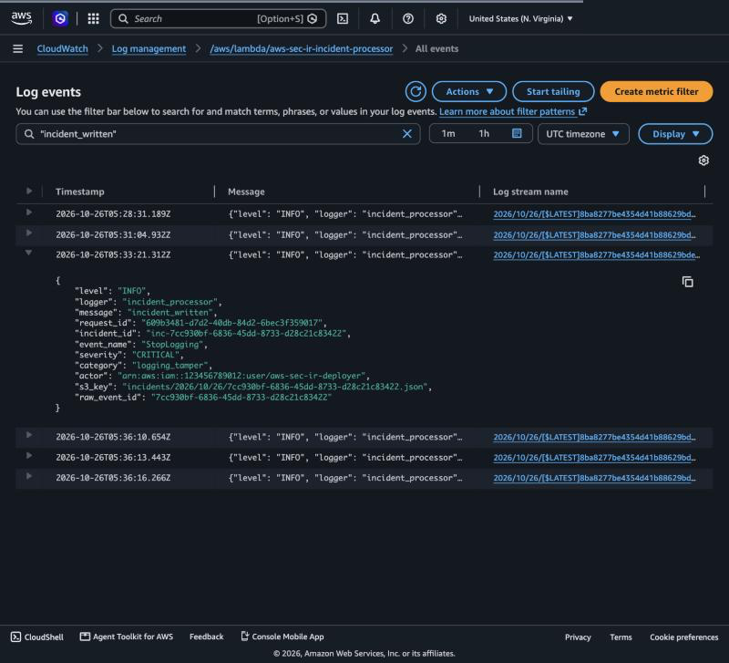
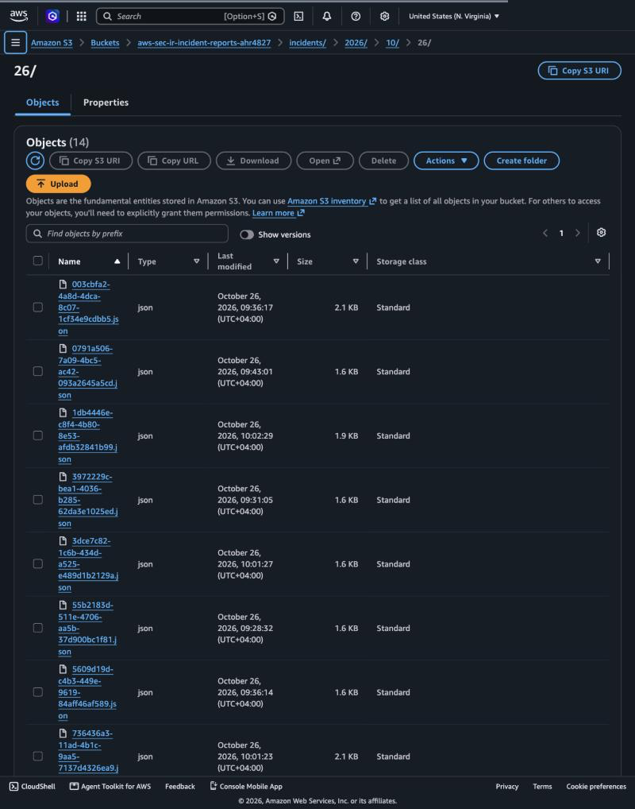
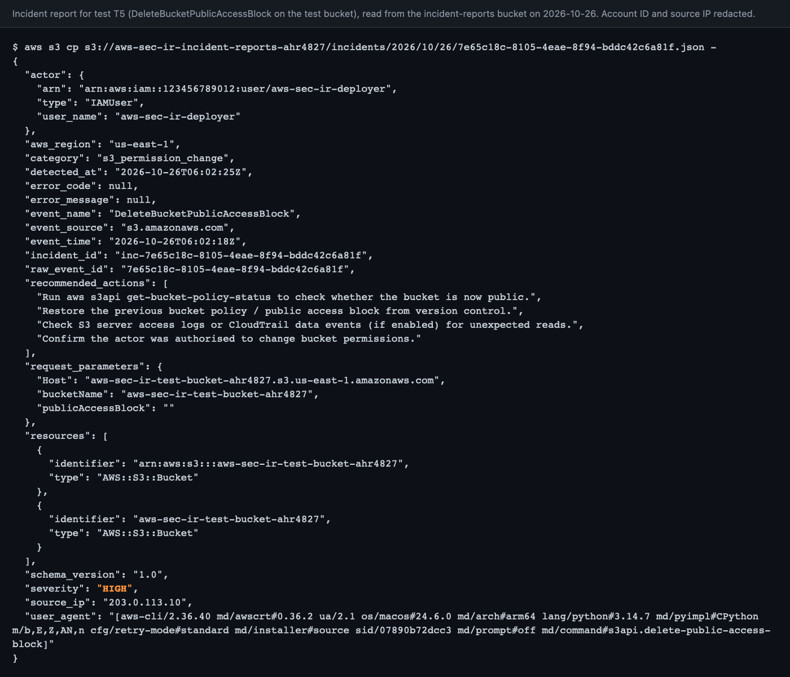

# AWS Cloud Security Monitoring and Automated Incident Response

A portfolio-ready, Terraform-deployed security monitoring pipeline for a single
AWS account. CloudTrail records management API calls, EventBridge rules match
suspicious ones, and a Lambda function writes a structured JSON incident report
to S3 for every detection. Everything runs inside the AWS Free Tier.

```
API activity (IAM, S3, CloudTrail)
        |
        v
CloudTrail (mgmt events) --> S3 audit-logs bucket
        |
        v
EventBridge (default bus) rules --match suspicious API calls--> Lambda incident-processor
                                                                        |
                                                                        v
                                                        S3 incident-reports bucket (JSON)
                                                                        |
                                                              (optional) SNS email
```

A second, independent path covers the case where the trail itself is switched
off: EventBridge Scheduler runs a health-check Lambda every 5 minutes that calls
`GetTrailStatus` and writes a CRITICAL incident if the trail is not logging.

Full diagram and component descriptions: [docs/architecture.md](docs/architecture.md).

## Detection rules

| Category | EventBridge source | Event names | Severity |
|---|---|---|---|
| IAM policy change | `aws.iam` | AttachUserPolicy, AttachRolePolicy, AttachGroupPolicy, PutUserPolicy, PutRolePolicy, PutGroupPolicy, CreatePolicy, CreatePolicyVersion, SetDefaultPolicyVersion | HIGH |
| Logging tamper | `aws.cloudtrail` | StopLogging, DeleteTrail, UpdateTrail, PutEventSelectors | CRITICAL |
| Trail not logging / missing (scheduled check) | EventBridge Scheduler, every 5 min | `TrailNotLogging`, `TrailMissing` (from `GetTrailStatus`) | CRITICAL |
| S3 permission change | `aws.s3` | PutBucketPolicy, DeleteBucketPolicy, PutBucketAcl, PutBucketPublicAccessBlock, DeleteBucketPublicAccessBlock, PutAccountPublicAccessBlock, DeleteAccountPublicAccessBlock | HIGH |

The rule patterns use CloudTrail **event** names, which are not always the API
operation names. S3 records the `PutPublicAccessBlock` API as
`PutBucketPublicAccessBlock` (bucket level) or `PutAccountPublicAccessBlock`
(account level). Test T5 caught this; see the design decisions.

Why these and not others: [docs/design-decisions.md](docs/design-decisions.md).
Report format: [docs/incident-schema.md](docs/incident-schema.md).

## Repository layout

```
terraform/   root module (s3, cloudtrail, detection, responder, notifications, test_resources)
lambda/      incident_processor.py (no third-party dependencies)
tests/       pytest unit tests + sample EventBridge events
scripts/     run_test_scenarios.sh, collect_evidence.sh, redact.sh, empty_bucket.sh
docs/        architecture, design decisions, test cases, schema, cost notes, teardown,
             evidence/ (redacted outputs), screenshots/ (redacted PNGs + checklist)
```

## Prerequisites

- An AWS account and a dedicated IAM user (not root) with the policy in
  [docs/deployer-policy.json](docs/deployer-policy.json) attached, configured as
  the CLI profile `sec-ir`.
- A billing budget (Billing → Budgets → zero-spend template) so you are alerted
  if anything is ever charged.
- Terraform >= 1.5, AWS CLI v2, Python 3.12+, `gh` (for the GitHub step only).

Beginner-friendly, click-by-click setup: [docs/my-tasks.md](docs/my-tasks.md).

## Deploy

```bash
cp terraform/terraform.tfvars.example terraform/terraform.tfvars
# edit bucket_suffix (your initials + 4 digits)
terraform -chdir=terraform init
terraform -chdir=terraform fmt -check
terraform -chdir=terraform validate
terraform -chdir=terraform plan -out=tfplan
terraform -chdir=terraform apply tfplan
```

Expected: 45 resources. 1 trail, 3 buckets (each with versioning, encryption, lifecycle,
public access block, ownership controls, policy), 3 EventBridge rules + 3
targets + 3 Lambda permissions, 1 Lambda + role + inline policy + log group,
1 test user, 1 test policy, and the health check (1 Lambda + role + policy +
log group, 1 schedule group, 1 schedule, 1 scheduler role + policy). Set
`enable_trail_health_check = false` to leave it out. Nothing is created
outside us-east-1.

## Run the tests

Unit tests (no AWS access needed):

```bash
python3 -m venv .venv && .venv/bin/pip install -r requirements-dev.txt
.venv/bin/python -m pytest
```

Controlled end-to-end scenarios (T1 to T6, each restores state afterwards):

```bash
AWS_PROFILE=sec-ir scripts/run_test_scenarios.sh
```

Then collect general stack evidence:

```bash
AWS_PROFILE=sec-ir scripts/collect_evidence.sh
```

Both write redacted outputs to `docs/evidence/`. Scenario definitions and
results: [docs/test-cases.md](docs/test-cases.md).

## Results summary

Tested on 2026-10-26. Unit tests: 32 passed.

| ID | Scenario | Expected | Result |
|---|---|---|---|
| T1 | IAM policy attach | HIGH `AttachUserPolicy` | PASS |
| T2 | Inline policy put | HIGH `PutUserPolicy` | PASS |
| T3 | Stop logging (restarted immediately) | CRITICAL `StopLogging` | **Partial: detected in 2 of 3 attempts** |
| T4 | Test-bucket policy change | HIGH `PutBucketPolicy` | PASS |
| T5 | Test-bucket public access block removed | HIGH `DeleteBucketPublicAccessBlock` | PASS after fixing the rule's event names |
| T6 | Benign calls | no incident | PASS |
| T7 | Scheduled trail health check, trail stopped | CRITICAL `TrailNotLogging` | PASS |

Incidents landed in S3 between 2 and 30 seconds after each API call. T3 is
partial because stopping the account's only trail can stop EventBridge from
receiving that same event. The scheduled trail health check (T7) closes that
gap by asking CloudTrail every 5 minutes whether the trail is logging; see
[design decisions, section 12](docs/design-decisions.md#12-the-stoplogging-blind-spot-observed-in-testing).
Full results: [docs/test-cases.md](docs/test-cases.md). Redacted evidence:
[docs/evidence/](docs/evidence/README.md).

| | |
|---|---|
|  |  |
|  |  |
|  |  |

All eleven screenshots: [docs/screenshots/](docs/screenshots/CHECKLIST.md).

## Cost

Designed for $0/month: one trail (first copy of management events is free), no
data events, no Insights, no CloudTrail → CloudWatch Logs, Lambda and
EventBridge inside always-free limits, S3 lifecycle expiry at 30 days. Details
and what to check in Billing: [docs/cost-notes.md](docs/cost-notes.md).

## Teardown

Empty the versioned buckets, then `terraform destroy`, then confirm no
`Project=aws-sec-ir` resources remain: [docs/teardown.md](docs/teardown.md).

## Lessons learned

- **API names are not always CloudTrail event names.** The spec listed `PutPublicAccessBlock` / `DeletePublicAccessBlock`; S3 logs them as `PutBucketPublicAccessBlock` / `DeleteBucketPublicAccessBlock` (or the `Account` variants). The first test run caught it because T5 produced no incident. Validate every pattern against real logged events.
- **Test the detection, not just the deployment.** `terraform apply` succeeded and the rule looked right in the console, yet one detection could never fire. Only an end-to-end scenario with an observed incident proves a rule works.
- **Read your own output critically.** The first incident reports had an always-null `eventbridge_rule` field, based on a wrong assumption about the EventBridge envelope. It was removed rather than kept as misleading data.
- **Detection is fast; CloudTrail search is slow.** Incidents landed in S3 2 to 30 seconds after the API call, while `lookup-events` took several minutes to index the same events. Poll with a timeout rather than assuming failure.
- **Evidence leaks more than account IDs.** CloudTrail records carry the caller's access key ID and public IP. The redaction script masks those too before anything is committed.
- **Restore steps are detections too.** Putting a bucket policy back is itself a permission change, so T4 and T5 raise extra HIGH incidents. That is correct; a production system would tie them to an approved change window.

## Future improvements

- Root console sign-in detection (`aws.signin` / `ConsoleLogin` with `userIdentity.type = Root`).
- Access-key and user creation detection (`CreateAccessKey`, `CreateUser`, `CreateLoginProfile`).
- SNS email (already wired, `enable_email_alerts = true`) or Slack via a webhook Lambda.
- Automated remediation for CRITICAL events (auto `start-logging`), with a tightly scoped remediation role.
- GuardDuty and Security Hub integration when cost is not a constraint.
- Multi-account: organization trail + EventBridge cross-account bus to a security account.
- Severity-based routing and a small dashboard built from the incident JSON.
