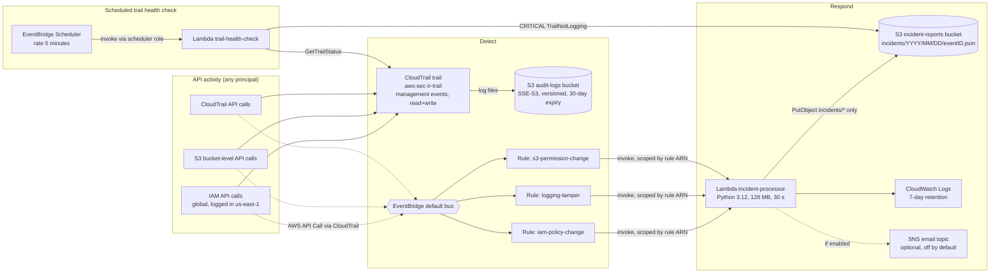

# Architecture

> `architecture.png`: not generated. No Mermaid renderer (`mmdc` / Node.js) is installed on the build machine, and installing one was not approved, so only the Mermaid source is provided. GitHub renders it inline. To export a PNG: `npm i -g @mermaid-js/mermaid-cli && mmdc -i docs/architecture.md -o docs/architecture.png`.

## Components

**CloudTrail trail (`aws-sec-ir-trail`).** The single trail in the account for this project. Management events only, read and write, single region (us-east-1) with global service events enabled so IAM calls are recorded. Log file validation is on (free). It delivers compressed JSON log files to the audit-logs bucket. There is deliberately no CloudWatch Logs destination (ingestion is billed) and no data events or Insights.

**EventBridge default bus and three rules.** Management events recorded by CloudTrail are also published to the EventBridge default bus as `AWS API Call via CloudTrail` events. Each rule matches one category of suspicious event names (see [detection table](../README.md#detection-rules)) and targets the Lambda. Matching AWS-service events on the default bus is free.

**Lambda `aws-sec-ir-incident-processor`.** Receives the event, classifies it with an in-code lookup table (severity, category, recommended actions), sanitizes request parameters, and writes one JSON report to the incident bucket keyed by the CloudTrail `eventID`. It logs structured JSON to its own log group and re-raises any failure so broken invocations show up as errors.

**S3 buckets.** Three buckets: `audit-logs` (CloudTrail), `incident-reports` (Lambda output) and `test-bucket` (the only bucket the test scenarios may modify). All have Block Public Access, ACLs disabled, versioning, SSE-S3, a 30-day/7-day lifecycle and a deny-non-TLS bucket policy. The audit bucket additionally lets `cloudtrail.amazonaws.com` write, restricted to this trail's ARN via `aws:SourceArn`.

**Test resources.** An IAM user with no credentials or permissions, a managed policy that allows only `sts:GetCallerIdentity`, and the test bucket. Scenarios T1 to T5 act on these and restore them afterwards.

**Scheduled trail health check.** EventBridge Scheduler invokes `aws-sec-ir-trail-health-check` every 5 minutes through a role that can invoke only that function. The function calls `cloudtrail:GetTrailStatus` on the project trail. If the trail is not logging, or no longer exists, it writes a CRITICAL incident to the same bucket and schema with `detection_source: scheduled_health_check`. This path exists because test T3 showed that stopping the only trail can stop EventBridge from receiving the `StopLogging` event itself. One incident is written per stop: repeated checks while the trail stays off overwrite the same object.

**Optional SNS topic.** Created only when `enable_email_alerts = true`; the Lambda then publishes each report to it.

## Data flow for one detection (example: T1)

1. `aws iam attach-user-policy` is called on the test user.
2. IAM records the `AttachUserPolicy` management event; CloudTrail writes it to the audit bucket (within ~5 to 15 minutes) and publishes it to EventBridge in us-east-1 (usually within a minute or two).
3. The `aws-sec-ir-iam-policy-change` rule matches `source = aws.iam` and `eventName = AttachUserPolicy` and invokes the Lambda.
4. The Lambda writes `incidents/2026/10/23/<eventID>.json` with severity HIGH and logs `incident_written`.
5. The test script polls the incident bucket, saves the report, the Lambda log excerpt and the `lookup-events` record as evidence.

## Why one region

IAM is a global service. Its CloudTrail events are delivered to EventBridge only in us-east-1, so the rules, the Lambda and the trail all live there. A second region would add nothing for IAM and would split the S3 and CloudTrail rules.
